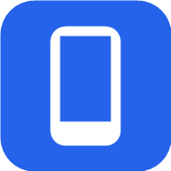

<h1> Vibb Phone</h1>

    

**Make a parent-curated, dumb-ish phone from any stock Android phone, Android 14 or newer.**

The idea is a phone that is useful without being exciting. It calls the family, takes messages from the people you chose,
plays the music you picked, shows the day and the way home, and then there is not much left to scroll. Nothing on it
is built to keep your child looking at the screen: no feeds, no autoplay, no streaks, and a lock screen that
shows only what you let through. As your child grows you open up more, one app at a time, like a map, a chat app or a
browser for school, and you decide what each app may use. It stays the same phone, and there is nothing new to buy.

Vibb began with a wish for exactly that: a near-dumb phone that could still show the family's photo album, talk on
the family's own chat server and play our own music. Phones and watches made for children each bring their own app,
their own cloud and their own subscription, and the family's data goes with them. Vibb uses the services your family
already runs, like [Immich](https://immich.app) for photos or a
[Matrix](https://matrix.org) server for chat, as ordinary apps you allow. The rules, the location history and the
contacts live on your own server and the child's phone, and nowhere else.

> [!WARNING]
> **Vibb is an early beta.** It has been tested a lot on emulators with Android 14 to 16 and on a Unihertz Jelly Star
> with Android 16, and real-world testing on more phones is under way. Android 17 is supported in the code but has
> seen little testing. Development moves fast, so expect breaking changes between versions.

## What it does

### On the child's phone

- **One app at a time.** Only the apps you picked open. For each one you choose whether it may use the camera,
  location, microphone or contacts. Apps from GitHub, F-Droid or your own upload install and update
  quietly from your server; an update that asks for more waits for you.
- **Only contacts get through.** Calls, SMS and MMS from numbers outside the phone book are stopped. A message from
  an unknown sender waits up to a day for you to allow or delete it. For each contact you choose calls and messages in each
  direction, and the child can ask to add a contact for you to approve. When your child is ready, turn the filter off
  for calls, for messages, or both. Emergency numbers always work.
- **A calm lock screen.** You choose which apps may show anything on the lock screen and how much: nothing, the
  name only, or the full text. Whether a notification wakes the screen or buzzes is your choice too.
- **Time rules** for school and bedtime, and a daily limit. The child can ask for more time, and you answer from your phone.
- **A calendar a child can read.** One very simple day view, which subscribes to the school's and the clubs'
  calendars (webcal and ICS links) and to the family's own CalDAV calendars. What the child adds goes to a family
  calendar you choose, so everyone sees it. The lock screen can show the next event and the weather from MET Norway.
- **Music you chose.** Vibb Music plays only what the parents put in its library: NRK, podcasts, Storytel books,
  Spotify playlists and your own files. It plays on the phone, or on the family's Sonos speakers when the child is at
  home. No feed, no recommendations, no ads.

### For the parents

- **A web app on your own phone**, with passkey sign-in, push notifications and an account for each
  parent. In Norwegian
  and English.
- **Location and zones** without Google's location service: arrived and left for the places you mark. Wi-Fi places are learned on the
  phone itself.
- **Find the phone**: ring it, see where it is, lock it or erase it.

### Under the hood

- **Locked down.** Vibb One is the device owner: the settings that matter are locked, and the child can't
  remove it. The phone uses Android's own PIN lock.
- **A web filter on the phone.** DNS block lists for ads and tracking, adult content, gambling and social media, any
  list you add yourself, and your own allowed sites. The phone filters on its own, on Wi-Fi and mobile data alike, and
  can ask your own DNS-over-HTTPS or DNS-over-TLS server.
- **Tailscale, if you want it.** Vibb One has a Tailscale client built in and can join your tailnet on its own, so
  your server never has to be reachable from the internet. Without it, the phones reach your server over HTTPS.
- **Works on a phone without Google.** Google Maps and Apple Maps links open as a pin, with the place's name and
  address, in [Organic Maps](https://organicmaps.app) or [CoMaps](https://www.comaps.app). A short link is read by your
  server, so the phone never opens Google. Vibb One is also a built-in [UnifiedPush](https://unifiedpush.org) distributor:
  Matrix apps such as Element X and FluffyChat get push through your server, with no extra app to install or keep updated.

## What it doesn't do

| | |
|---|---|
| Send data to us | There is no "us". The server is yours. |
| Depend on Google | Vibb itself uses no Firebase push and no Google location service. |
| Need a Google account | Optional, only for the Play Store. |
| Ask you to trust unsigned builds | Signed APKs, minisign-signed server releases, attested Docker images. |

## Where the privacy ideas come from

Some of this follows other projects:

- **GrapheneOS**: blocking 2G, fresh Wi-Fi addresses on open networks, and Apple's Wi-Fi lookup asked through a proxy
  instead of Google's location service. Vibb's Apple lookup uses GrapheneOS's request format. It is off until you
  turn it on for a phone, it is asked by your server and never by the phone, and the Docker setup sends it through
  Tor with a new circuit for every call. Apple sees the networks' hardware addresses and a Tor exit, never the phone, a
  name or your home's address.
- **microG and Local NLP Backend**: learning Wi-Fi places on the phone, and their lists of hotspots that move (trains,
  buses, phones) so those never teach a place.
- **Android's own controls**: no screen content goes to Google's on-device AI or the assistant, and Chrome sends no
  usage data and has no sign-in. The setup list shows you where to turn off the advertising ID, usage reports, number
  verification and Play Protect uploads.

**What Vibb can't promise.** On a stock Android phone, Android itself and Google Play services still talk to Google
in the background, for example to check the network, set the clock and speed up GPS, and the phone maker's own apps
may do the same. Vibb adds nothing to that and turns off what it can, but it doesn't make a stock phone Google-free.
A phone running GrapheneOS removes most of it.

## Parts

| Folder | What | Built with |
|---|---|---|
| [`launcher/`](launcher/) | Vibb One: Home screen and device-owner agent | Kotlin, Android 14–17 |
| [`music/`](music/) | Vibb Music: the child's player | Kotlin, Compose, Media3 |
| [`server/`](server/) | The server and the parents' web app | Rust, Axum, SQLite |

The design notes and reviews are in [`docs/`](docs/).

## Start

1. **Run the server** with Docker: [`docs/setup/quick-start.md`](docs/setup/quick-start.md). Everything else, a
   Raspberry Pi, Caddy or Tailscale, is in [`server/DEPLOY.md`](server/DEPLOY.md).
2. **Add a phone**: *Devices › Add Phone* in the web app, then scan the setup QR on a new or reset phone.
3. **Follow the setup list** the web app shows for the phone, and choose its apps, contacts and rules.

## Talk to us

Questions, ideas and help: the Matrix room [`#launcher:vibb.me`](https://matrix.to/#/#launcher:vibb.me). Bugs go in
[GitHub issues](https://github.com/palchrb/vibb-launcher/issues).

## Thanks

Vibb stands on other people's work:

- [kids-launcher-mdm](https://github.com/siesta5787/kids-launcher-mdm) and
  [kid-phone-server](https://github.com/siesta5787/kid-phone-server) by siesta5787, where Vibb One and the server
  began, and [µLauncher](https://github.com/jrpie/launcher), whose app list Vibb One still uses.
- [ntfy](https://github.com/binwiederhier/ntfy): Vibb's UnifiedPush server and Matrix gateway are ported in part
  from it. [UnifiedPush](https://unifiedpush.org) for the protocol and the distributor code we adapted.
- [GrapheneOS NetworkLocation](https://github.com/GrapheneOS/platform_packages_apps_NetworkLocation),
  [microG](https://github.com/microg/GmsCore), [Local NLP Backend](https://github.com/Helium314/Local-NLP-Backend)
  and Déjà Vu for location; [DNS66](https://github.com/julian-klode/dns66) for the shape of the on-phone DNS filter.
- [AOSP Messaging](https://android.googlesource.com/platform/packages/apps/Messaging) for the MMS codec,
  [Tailscale](https://github.com/tailscale/tailscale)'s tsnet for the phone's own tailnet link.
- [Yr](https://github.com/nrkno/yr-weather-symbols) and [MET Norway](https://api.met.no) for the weather,
  [Material Symbols](https://github.com/google/material-design-icons) and [Nunito](https://github.com/googlefonts/nunito).

The full list, with licences and what we changed, is in [`NOTICE.md`](NOTICE.md). Vibb is GPL-3.0-or-later.
